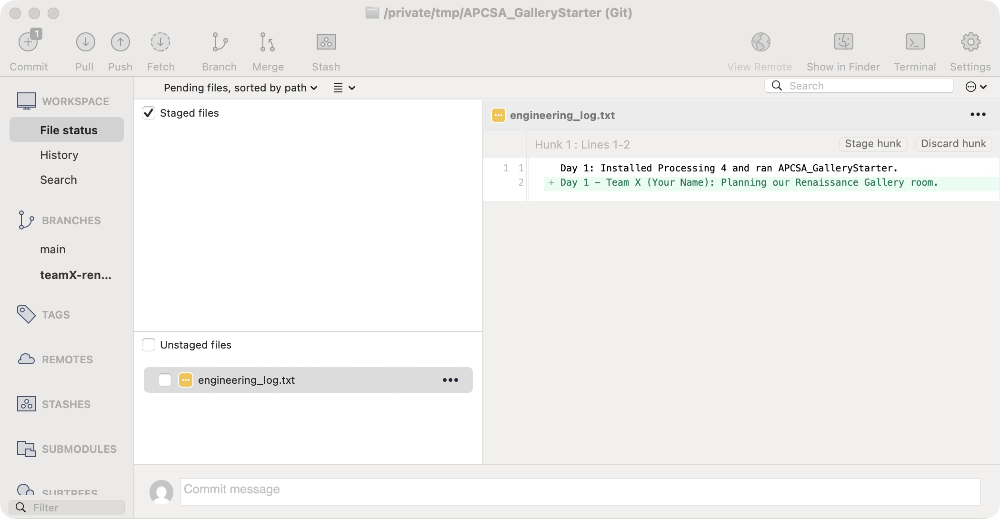
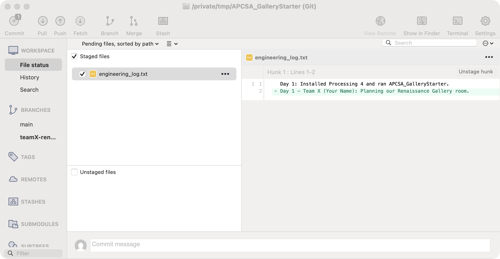
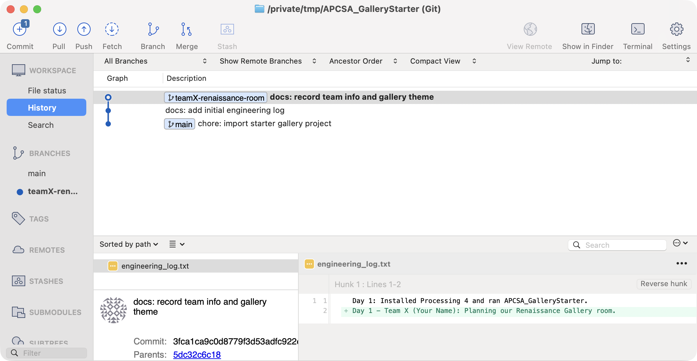

# Unit 3 Lab 4 Setup: Processing 4 Installation & Git Basics
{: .no_toc }

## Overview
{: .no_toc }
Before you start building your 3D Virtual Gallery room, follow this guide to install **Processing 4**, set up **Git** (via Terminal or the visual **Sourcetree** app), and practice the version control workflow your team will use throughout the project's Software Development Life Cycle (SDLC).

## Table of Contents
{: .no_toc .text-delta }
1. TOC
{:toc}

---

## Part 1: Installing Processing 4

### 1. Download Processing 4
Download the official installer for your operating system from the Processing website:

* **Official Download Link:** **[https://processing.org/download](https://processing.org/download)**

Choose the build that matches your laptop:
* **macOS (Apple Silicon — M1 / M2 / M3 / M4):** Download **macOS (Apple Silicon)**
* **macOS (Intel):** Download **macOS (Intel)**
* **Windows:** Download **Windows (Intel 64-bit)**

### 2. Install & Launch
* **On macOS:**
  1. Unzip the downloaded `.zip` archive (or open the `.dmg`).
  2. Drag **`Processing.app`** into your **`Applications`** folder.
  3. Open **Processing** from Applications (if macOS asks for confirmation on first launch, click **Open**).
* **On Windows:**
  1. Right-click the downloaded `.zip` file and select **Extract All...** to a permanent folder (e.g., `C:\Processing\`).
  2. Double-click **`processing.exe`** inside the extracted folder to launch Processing 4.

### 3. Configure Memory (Recommended: 4096 MB)
3D galleries with high-resolution paintings (`.jpg`/`.png`) and 3D statue meshes (`.obj`) need more memory than Processing's small default setting. Configure this once:

1. Open Processing 4 and go to **Processing → Settings...** (`Cmd + ,` on macOS) or **File → Preferences...** (`Ctrl + ,` on Windows).
2. Check **"Increase maximum available memory to:"** and enter **`4096`** MB.
3. Click **OK** and restart Processing.

### 4. Download & Unzip the Starter Project from GitHub
Download the starter gallery project as a ZIP archive from GitHub:

1. Open the starter repository on GitHub: **[https://github.com/novemberwu/APCSA_GalleryStarter](https://github.com/novemberwu/APCSA_GalleryStarter)**
2. Click the green **`<> Code`** button near the top right, then click **Download ZIP** to save **`APCSA_GalleryStarter-main.zip`** to your computer.
3. **Unzip the file:**
   * **On Windows:** Right-click **`APCSA_GalleryStarter-main.zip`**, select **Extract All...**, and extract it to a permanent folder (for example, `Documents\Processing\`). *(Do not try to run the program from inside the `.zip` preview window.)*
   * **On macOS:** Double-click **`APCSA_GalleryStarter-main.zip`** in Finder to unzip it, then move the extracted folder into `~/Documents/Processing/`.
4. **Remove the `-main` suffix from the folder name:**
   * GitHub automatically appends the branch name (`-main`) to downloaded ZIP folders, so the extracted folder will be named **`APCSA_GalleryStarter-main`**.
   * Rename the folder from **`APCSA_GalleryStarter-main`** to **`APCSA_GalleryStarter`**. *(On Windows, if extracting created a nested folder like `APCSA_GalleryStarter-main\APCSA_GalleryStarter-main`, rename the inner folder that directly contains `APCSA_GalleryStarter.pde`.)*

{: .warning }
> **Why you must remove `-main`:**
> Processing requires the sketch folder name to **exactly match** the main `.pde` file name (`APCSA_GalleryStarter.pde`). If the folder is still named `APCSA_GalleryStarter-main`, Processing will ask to move the file into a new subfolder, separating it from the other `.pde` tabs and `data/` assets.

### 5. Open & Run the Starter Gallery
1. Open your **`APCSA_GalleryStarter`** folder and double-click **`APCSA_GalleryStarter.pde`** to open the project in Processing 4 *(or launch Processing 4, select **File → Open...**, and choose `APCSA_GalleryStarter/APCSA_GalleryStarter.pde`)*.

{: .important }
> **Rule of Processing Sketches:**
> Always open the **`.pde` file whose name matches the folder name** (`APCSA_GalleryStarter.pde`). Processing automatically loads all other `.pde` tabs (`Painting.pde`, `Statue.pde`, `GalleryLight.pde`, `Room1_Mythology.pde`, `Room2_StudentTemplate.pde`, `Doorway.pde`, `GalleryEngine.pde`) in the same window.

2. Click the **Play (`▶`)** button in the top-left corner to launch the 3D Virtual Gallery!
3. **Adding Artworks Easily:** To add a painting image (`.jpg`/`.png`) or 3D statue (`.obj`/`.mtl`/`.png`), either copy the files into the sketch's `data/` folder or **drag and drop** them directly onto the Processing editor window.

*(Optional macOS Terminal Launch:)*
```sh
/Applications/Processing.app/Contents/MacOS/Processing cli --sketch=~/Documents/Processing/APCSA_GalleryStarter --run
```

---

## Part 2: Basic Usage of Git

**Git** is a version control system used by software engineers to track changes, collaborate safely in teams, and recover previous versions if something breaks.

### 1. Check / Install Git & Configure Your Identity
Open **Terminal** (macOS) or **Git Bash** (Windows) and check if Git is installed:

```sh
git --version
```

* **If Git is not installed:**
  * **macOS:** Run `xcode-select --install` in Terminal and click **Install**.
  * **Windows:** Download and install Git from **[https://git-scm.com/downloads](https://git-scm.com/downloads)**.

Next, set your name and email once so every commit records who authored the change:

```sh
git config --global user.name "Your Name"
git config --global user.email "your.email@school.edu"
```

---

### 2. Initialize a Local Git Repository (`git init`)
Because you already downloaded and unzipped the starter project in Part 1, initialize Git directly inside your `APCSA_GalleryStarter` folder so you can track versions locally and safely revert mistakes:

```sh
cd ~/Documents/Processing/APCSA_GalleryStarter
git init
git add .
git commit -m "chore: import starter gallery project"
```

*(Making this first baseline commit saves a clean snapshot of the original starter code before you make any edits.)*

---

### 3. Create Your Team Branch (Never Code Directly on `main`)
Before making any edits, create a dedicated branch for your team:

```sh
git checkout -b teamX-renaissance-room
```

Check which branch you are currently on at any time:

```sh
git branch
```

---

### 4. The Core Local Git Cycle (`status` → `add` → `commit`)

Follow this cycle after every milestone instead of saving everything for one giant commit at the end:

1. **Check what files changed:**
   ```sh
   git status
   ```
2. **Stage the files you want to save:**
   ```sh
   git add Room2_StudentTemplate.pde data/
   ```
   *(Tip: Check `git status` first so you don't accidentally add temporary files or 200 MB raw downloads.)*
3. **Commit with a clear, descriptive message:**
   ```sh
   git commit -m "feat(room2): add 4 curated paintings and GalleryLight preset"
   ```

#### Recommended 5 Milestone Commits (SDLC Rubric)
* **Commit 1:** Room title, curator credit, `GalleryLight`, and `for`-loop ceiling beams & floor medallions.
* **Commit 2:** 4 wall `Painting` objects + optimized images (`<= 2560px`) in `data/`.
* **Commit 3:** 2 floor `Statue` objects + decimated `.obj`/`.mtl`/`.png` files (`<= 50k` faces) in `data/`.
* **Commit 4:** Proximity selectors (`getActivePainting`, `getActiveStatue`) & wall/pedestal collision (`canMoveTo`).
* **Commit 5:** Lighting tuning, bug fixes, and final 3D walkthrough verification.

---

### 5. (Optional) Push to a Remote Repository on GitHub
Local Git already gives you full version history and rollback on your own computer. If you also want an online backup or want to share code with a teammate via GitHub:

1. Create a new **empty** repository on GitHub (do **not** initialize it with a README or `.gitignore`) and copy its URL (e.g., `https://github.com/<your-username>/APCSA_GalleryStarter.git`).
2. Connect your local repository to that remote URL once:
   ```sh
   git remote add origin https://github.com/<your-username>/APCSA_GalleryStarter.git
   ```
3. Push your branch to GitHub:
   ```sh
   git push -u origin teamX-renaissance-room
   ```
   *(After the first push with `-u`, future pushes only need `git push`.)*

---

### 6. Inspecting History & Recovering Mistakes

* **View your commit history:**
  ```sh
  git log --oneline
  ```
* **See exact line-by-line changes before committing:**
  ```sh
  git diff
  ```
* **Recover an accidentally deleted or broken file** (restores the file from your last commit!):
  ```sh
  git restore APCSA_GalleryStarter.pde
  ```
* **Unstage a file you added by mistake** (keeps your edits on disk):
  ```sh
  git restore --staged <filename>
  ```
* **Pull latest updates from your teammate on the same branch** *(if using a remote GitHub repo)*:
  ```sh
  git pull
  ```

---

### 7. Git Quick Reference Cheat Sheet

| Command | What It Does | When to Use It |
| :--- | :--- | :--- |
| `git init` | Initializes a new local Git repository in the current folder | Once after unzipping the starter project |
| `git checkout -b <branch>` | Creates and switches to a new feature branch | Once when starting your team's room |
| `git status` | Shows modified, staged, and untracked files | Before every `git add` and `git commit` |
| `git diff` | Shows exact code changes since the last commit | Reviewing your work before committing |
| `git add <file>` | Stages a file or folder for the next commit | After finishing a milestone |
| `git commit -m "msg"` | Saves a permanent local snapshot with a message | At each milestone (4–5+ times per project) |
| `git remote add origin <url>` | Links your local repository to a remote GitHub repo | Optional, once before your first push |
| `git push` | Uploads your commits to GitHub | Optional, to back up work or share with a teammate |
| `git pull` | Downloads your teammate's latest commits | Optional, when collaborating via a remote repo |
| `git log --oneline` | Displays a compact list of past commits | Checking milestone history |
| `git restore <file>` | Restores a deleted or broken file to the last commit | When you accidentally break or delete a file |

---

## Part 3: Guided Example & Hands-On Practice Task

Now put the Git cycle into practice inside your `APCSA_GalleryStarter` folder. Follow the guided example first, then complete the practice task on your own.

### Guided Example: Tracking an `engineering_log.txt` File

Follow these steps in **Terminal** (macOS) or **Git Bash** (Windows):

1. **Navigate into your project folder and initialize Git:**
   ```sh
   cd ~/Documents/Processing/APCSA_GalleryStarter
   git init
   ```
   *(If you already ran `git init` in Part 2, running it again is safe—Git will simply keep your existing repository.)*

2. **Create a new file named `engineering_log.txt` and add your first log entry:**
   ```sh
   echo "Day 1: Installed Processing 4 and ran APCSA_GalleryStarter." > engineering_log.txt
   ```
   *(Alternatively, create `engineering_log.txt` in any text editor and save it directly inside the `APCSA_GalleryStarter` folder.)*

3. **Check what Git sees (`git status`):**
   ```sh
   git status
   ```
   Notice that `engineering_log.txt` appears in red under **Untracked files**—Git sees the new file, but is not saving it yet.

4. **Stage the file (`git add`) and check status again:**
   ```sh
   git add engineering_log.txt
   git status
   ```
   `engineering_log.txt` now appears in green under **Changes to be committed**.

5. **Save a permanent snapshot (`git commit`):**
   ```sh
   git commit -m "docs: add initial engineering log"
   ```

6. **Verify your commit history (`git log`):**
   ```sh
   git log --oneline
   ```
   You should see a short commit ID next to your message `docs: add initial engineering log`.

---

### Your Turn: Hands-On Practice Task

Complete the following steps on your own to practice the full edit → diff → commit → recover workflow:

1. **Add a second log entry:**
   Open `engineering_log.txt` (or use `>>` in the terminal so you **append** without overwriting line 1) and add a new line containing your **name**, **team number**, and **gallery room theme**:
   ```sh
   echo "Day 1 - Team X (Your Name): Planning our Renaissance Gallery room." >> engineering_log.txt
   ```
2. **Inspect your unstaged changes:**
   Run `git status` and `git diff`. Confirm that `engineering_log.txt` is listed as **modified** and that `git diff` highlights your newly added line with a `+`.
3. **Stage and commit your update:**
   Run `git add engineering_log.txt`, then commit with a clear, descriptive message (for example, `git commit -m "docs: record team info and gallery theme"`).
4. **Practice recovering from a mistake (`git restore`):**
   * Intentionally delete a line or type random text into `engineering_log.txt` and save the file.
   * Run `git status` to see the unwanted modification.
   * Run `git restore engineering_log.txt` and open the file again—your last committed version is cleanly restored!
5. **Checkoff verification:**
   Run `git log --oneline` and confirm your history shows **both** of your `engineering_log.txt` commits. Keep your terminal output ready to show your teacher as your Unit 3 Lab 4 setup checkoff.

{: .note }
> **Optional Next Step:**
> If you want to back up your repository online or share it with a teammate, follow [Part 2, Step 5](#5-optional-push-to-a-remote-repository-on-github) to connect a GitHub repository and push your commits.

---

## Part 4: Visual Git with Sourcetree (Optional GUI)

If you prefer a visual interface over typing commands in Terminal / Git Bash, you can manage the exact same Git repository using **Sourcetree**—a free Git GUI client for macOS and Windows. Everything you do in Sourcetree uses real Git underneath, so you can switch freely between Sourcetree and the command line at any time.

### 1. Download & Install Sourcetree
* **Official Download Link:** **[https://www.sourcetreeapp.com/](https://www.sourcetreeapp.com/)**
* **First-Time Setup:**
  1. Install and launch **Sourcetree**.
  2. When asked to connect a Bitbucket or GitHub account, you can click **Skip** if you only want local Git for now.
  3. Enter your **Name** and **Email** when prompted (this sets the same author identity as `git config`).

### 2. Open Your `APCSA_GalleryStarter` Folder in Sourcetree
* **If you already ran `git init` in Part 2:**
  Click **New... → Add Existing Local Repository** (macOS) or **+ → Add** (Windows), then select your **`APCSA_GalleryStarter`** folder.
* **If you have not initialized Git yet:**
  Click **New... → Create Local Repository** (macOS) or **+ → Create** (Windows), select your **`APCSA_GalleryStarter`** folder, and click **Create** *(this runs `git init` for you)*.

Double-click **`APCSA_GalleryStarter`** in Sourcetree's repository list to open the workspace window.

### 3. Essential Git Operations in Sourcetree

| Git CLI Command | How to Do It in Sourcetree |
| :--- | :--- |
| `git init` | **New... → Create Local Repository** and choose `APCSA_GalleryStarter` |
| `git checkout -b <branch>` | Click **Branch** in the top toolbar, enter `teamX-renaissance-room`, and click **Create Branch** |
| `git status` & `git diff` | Click **File Status** (under **WORKSPACE** in the left sidebar), then click any file under **Unstaged files** to view red (`-`) / green (`+`) diffs on the right |
| `git add <file>` | Check the box next to the file (or click **Stage Selected** / **Stage All**) to move it into **Staged files** |
| `git commit -m "msg"` | Type your commit message in the bottom text box and click **Commit** |
| `git log --oneline` | Click **History** (or your branch under **BRANCHES**) in the left sidebar to view the visual commit timeline |
| `git restore <file>` | In **File Status**, right-click a modified file under **Unstaged files** and select **Discard...** |
| `git remote add origin <url>` | *(Optional)* Click **Settings** (top-right) → **Remotes** → **Add**, enter `origin` and your GitHub repo URL |
| `git push` / `git pull` | *(Optional)* Click **Push** or **Pull** in the top toolbar once a remote repo is connected |

### 4. Trying the `engineering_log.txt` Cycle in Sourcetree
Try repeating the practice workflow visually in Sourcetree:

1. **Edit the file:** Open `engineering_log.txt` in any text editor, add a new line, and save.
2. **Inspect status & diff:** Switch to Sourcetree and click **File status** in the left sidebar. Click `engineering_log.txt` under **Unstaged files**—the right-hand panel highlights your added line in green:

   

3. **Stage the change & commit:** Check the box next to `engineering_log.txt` so it moves up into **Staged files**. Then type a clear commit message in the **Commit message** box at the bottom (e.g., `docs: record team info and gallery theme`) and click **Commit**:

   

4. **View history & branch graph:** Click **History** in the left sidebar to see your new commit appear at the top of your `teamX-renaissance-room` branch timeline, with the file diff below:

   

{: .tip }
> **Safe Undo in Sourcetree:**
> If you ever make an accidental edit to a `.pde` file or `engineering_log.txt` before committing, go to **File status**, right-click the file under **Unstaged files**, and choose **Discard...** (or click **Discard hunk** in the diff panel)—this performs the exact same safe rollback as `git restore <file>`.
