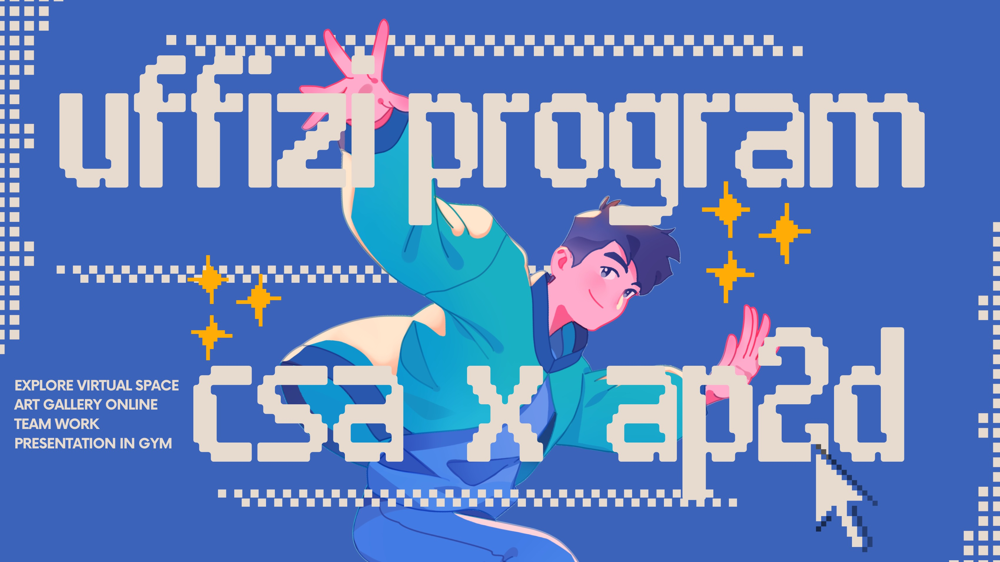

# Unit 3 Lab 4: Capstone — 3D Virtual Gallery in Processing
{: .no_toc }



## Goals
{: .no_toc }
* Apply the complete object-oriented workflow from Labs 1–3 (**Writing Classes, Encapsulation, Constructor Overloading, and Instance Methods**) in an interactive 3D graphical environment.
* Understand **Object Composition** (*has-a* relationships): a `Room` object *has four* wall `Painting` objects, *two* 3D floor `Statue` objects, and *one* `GalleryLight` object controlling the room's illumination.
* Connect core skills across **AP CSA Units 1–3** without requiring **Unit 4 (Data Collection / Arrays / ArrayLists)**:
  * **Unit 1 (Elementary Programming):** Primitive variables (`float`, `int`, `boolean`), `Math.sqrt`/`Math.pow` for 2D Euclidean distance, and `String` methods (`toUpperCase()`).
  * **Unit 2 (If/Else & Loops):** Compound boolean expressions (`&&`, `||`, `!`) for 3D wall and circular statue pedestal collision, `if / else-if` proximity checks, and `for` loops for repeating architectural ceiling beams and floor medallion patterns.
  * **Unit 3 (Creating Classes):** Class anatomy, private instance variables (encapsulation), **overloaded constructors with `this(...)`**, instance methods, and object composition (`Room` composed of `Painting` and `Statue` instances).
* Curate **4 wall paintings** (`.png`/`.jpg`) and **2 floor sculptures** (`.obj` 3D meshes or Renaissance marble styles) with AP 2D Art analysis (Form, Content, Context).
* Practice a real-world **Software Development Life Cycle (SDLC)**: plan architecture and asset budgets with your partner, configure a local development environment, use **Git** branching and incremental commits, and verify your room with automated tests and 3D walkthrough checklists.
* Implement your own custom 3D museum gallery room using the starter kit in `~/Documents/Processing/APCSA_GalleryStarter`.

## Task Summary
{: .no_toc .text-delta }
1. TOC
{:toc}

---

## Part 1: Project Overview & Architecture

Welcome to the **AP CSA Virtual Museum Capstone Project**! In this lab, you will step beyond text-based console output into an immersive 3D world rendered in real-time with **Java Processing (`P3D`)**.

```
+---------------------------------------------------------------------------------+
|                                 VIRTUAL MUSEUM ARCHITECTURE                     |
+---------------------------------------------------------------------------------+
|                                                                                 |
|   +-------------------------+   Open Arch    +-------------------------+        |
|   |     Room1_Mythology     |   Doorway      |  Room2_StudentTemplate  |        |
|   | (Botticelli Gallery)    | <============> |   (Your Curated Room)   |        |
|   |                         | (See-Through)  |                         |        |
|   | Wall Paintings (4):     |                | Wall Paintings (4):     |        |
|   | - westPainting          |                | - westPainting          |        |
|   | - eastPainting          |                | - eastPainting          |        |
|   | - northLeftPainting     |                | - northLeftPainting     |        |
|   | - northRightPainting    |                | - northRightPainting    |        |
|   |                         |                |                         |        |
|   | Floor Statues (2):      |                | Floor Statues (2):      |        |
|   | - westFloorStatue       |                | - westFloorStatue       |        |
|   | - eastFloorStatue       |                | - eastFloorStatue       |        |
|   +-------------------------+                +-------------------------+        |
|             |             \                    /             |                  |
|             |              \                  /              |                  |
|             v               v                v               v                  |
|   +--------------------+     +------------------------------+                   |
|   |   Painting Class   |     |         Statue Class         |                   |
|   | (Wall Canvas+Frame)|     | (3D .obj Mesh/Marble+Pedestal|                   |
|   +--------------------+     +------------------------------+                   |
+---------------------------------------------------------------------------------+
```

### How the Multi-Room Museum Works
1. Every student room is an encapsulated Java class centered at local coordinates $$(0, 0)$$.
2. A room contains **4 `Painting` objects** mounted on the walls and **2 `Statue` objects** placed on 3D pedestals on the gallery floor.
3. The North center wall ($$z = -600$$, $$x \in [-90, +90]$$) and South center wall ($$z = +600$$, $$x \in [-90, +90]$$) are reserved for open stone archway **`Doorway`** objects.
4. Doorways are **100% open and see-through**: you can see the adjacent room's paintings and rotating statues directly through the archway and walk continuously from room to room using `W` / `Up Arrow`!

---

## Part 2: Project File Structure

The project starter files are located in Processing IDE format at `~/Documents/Processing/APCSA_GalleryStarter/`:

| File | Owner | Concepts & Role |
| :--- | :--- | :--- |
| `Painting.pde` | **Core Model Class 1** | Encapsulates one wall painting (`title`, `artist`, dimensions, 3D wall position, textures, and proximity detection). |
| `Statue.pde` | **Core Model Class 2** | Encapsulates one 3D floor sculpture (`title`, `sculptor`, `.obj` mesh or marble style, pedestal type, rotation speed, circular collision radius, and overloaded constructors). |
| `GalleryLight.pde` | **Core Model Class 3** | Encapsulates the room's 3D lighting conditions (`lightName`, preset styles `"WARM_MUSEUM"`, `"NATURAL_DAYLIGHT"`, `"DRAMATIC_CHIAROSCURO"`, `"SOFT_CONSERVATION"`, intensity `[0.20..1.40]`, and anti-glare canvas exposure). |
| `Room1_Mythology.pde` | **Reference Model** | Complete, working room modeling *Sala I: Botticelli Myth, Allegory & Classical Sculpture* (4 paintings + 2 rotating `.obj` floor statues + warm museum light). |
| `Room2_StudentTemplate.pde` | **Student Workspace** | Your canvas! Contains step-by-step `// === STUDENT TODO ===` markers for your team's 4 paintings and 2 floor statues. |
| `Doorway.pde` | Teacher Framework | Renders open Renaissance *pietra serena* stone archways and manages room-to-room walk-through transitions. |
| `GalleryEngine.pde` | Teacher Framework | Handles 3D camera controls (`WASD`/Arrows + mouse), lighting, gold leaf frames, `.obj` normalization, 3D pedestals, and the Curator HUD. |
| `APCSA_GalleryStarter.pde` | Main Sketch | Instantiates student rooms, renders see-through neighbor rooms, and links rooms with doorways. |
| `data/` | Asset Folder | Contains artwork `.png`/`.jpg` textures and 3D `.obj` statue models (`statue.obj`, `vase.obj`). |

---

## Part 3: Deep Dive into `Painting.pde` and `Statue.pde`

### 1. Wall Artwork Abstraction: `Painting.pde`
Inspect `Painting.pde`. Notice how every technique learned in Labs 1, 2, and 3 is applied to a wall-mounted painting:

```java
class Painting {
  // 1. [AP CSA Unit 3: Class Creation] Private Instance Variables (Encapsulation)
  private String title;
  private String artist;
  private String yearAndMedium;
  private String formAndContent;     // AP 2D Art Form & Content
  private String historicalContext;  // AP 2D Art Context

  private String wallSide;           // "NORTH", "SOUTH", "EAST", "WEST"
  private float x, y, z;
  private float frameWidth, frameHeight;
  private boolean isCircularTondo;   // true for circular Renaissance tondi

  private PImage canvasImage;
  private PImage plaqueImage;

  // 2. [AP CSA Unit 3: Class Creation] Constructor (Object Initialization)
  public Painting(
      GalleryEngine engine,
      String title, String artist, String yearAndMedium,
      String imageFileName, String wallSide,
      float x, float y, float z,
      float frameWidth, float frameHeight,
      boolean isCircularTondo,
      String formAndContent, String historicalContext) {

    this.title = title;
    this.artist = artist;
    this.yearAndMedium = yearAndMedium;
    this.wallSide = wallSide;
    this.x = x;
    this.y = y;
    this.z = z;
    this.frameWidth = frameWidth;
    this.frameHeight = frameHeight;
    this.isCircularTondo = isCircularTondo;
    this.formAndContent = formAndContent;
    this.historicalContext = historicalContext;

    if (engine != null) {
      this.canvasImage = engine.loadOrCreateArtwork(imageFileName, title);
      this.plaqueImage = engine.createWallPlaqueTexture(title, artist, yearAndMedium);
    }
  }

  // 3. [AP CSA Unit 1: Math & Primitives] 2D Euclidean Distance Calculation
  public float distanceToVisitor(float visitorX, float visitorZ) {
    double dx = this.x - visitorX;
    double dz = this.z - visitorZ;
    return (float) Math.sqrt(Math.pow(dx, 2) + Math.pow(dz, 2));
  }

  // [AP CSA Unit 2: Boolean Expressions] Proximity Check
  public boolean isVisitorNear(float visitorX, float visitorZ) {
    return distanceToVisitor(visitorX, visitorZ) < 250.0f;
  }

  // [AP CSA Unit 1: String Methods] Formatted Header
  public String getFormattedHeader() {
    return this.title.toUpperCase() + "  |  " + this.artist + " (" + this.yearAndMedium + ")";
  }

  // [AP CSA Unit 3: Instance Methods & Unit 1: Calling Object Methods]
  public void display(GalleryEngine engine) {
    engine.drawFramedPaintingOnWall(
      this.canvasImage, this.plaqueImage, this.wallSide,
      this.x, this.y, this.z, this.frameWidth, this.frameHeight,
      this.isCircularTondo
    );
  }
}
```

---

### 2. 3D Floor Sculpture Abstraction: `Statue.pde`
Unlike a flat painting hung on a wall, a 3D **`Statue`** sits on the walkable gallery floor at $$(x, z)$$. This introduces three new object-oriented design requirements:
1. **3D Mesh & Pedestal Encapsulation:** A statue encapsulates a 3D model (`modelOrStyle`: either a Wavefront `.obj` file like `"statue.obj"` / `"vase.obj"` or a procedural marble style like `"VENUS_MARBLE"`, `"MEDICI_BUST"`, `"PORPHYRY_URN"`), a `pedestalType` (`"BLOCK"`, `"ROTATING"`, or `"COLUMN"`), and an animated `rotatingSpeed` (degrees/second).
2. **Constructor Overloading (`this(...)`):**
   * **Constructor 1 (Full Constructor):** Lets the curator specify custom `pedestalType` and `rotatingSpeed`.
   * **Constructor 2 (Overloaded Default Constructor):** Uses `this(..., "BLOCK", 30.0f, ...)` to default to a classic stone block pedestal rotating at `30.0` degrees/second.
3. **Circular Pedestal Collision (`collidesWithVisitor`):** Because pedestals stand inside the room, visitors must not walk through them! Calling `collidesWithVisitor(nextX, nextZ)` checks whether `distanceToVisitor(nextX, nextZ) < this.collisionRadius` (`72.0f`).

```java
class Statue {
  // 1. [AP CSA Unit 3: Class Creation] Private Instance Variables
  private String title;
  private String sculptor;
  private String yearAndMedium;
  private String modelOrStyle;      // "statue.obj", "vase.obj", "VENUS_MARBLE", "MEDICI_BUST", "PORPHYRY_URN"
  private String pedestalType;      // "BLOCK", "ROTATING", or "COLUMN"
  private float x;                  // Floor X coordinate (room center is 0)
  private float z;                  // Floor Z coordinate (room center is 0)
  private float rotatingSpeed;      // Degrees per second (0 = stationary)
  private float collisionRadius;    // Circular collision radius (72.0f) around pedestal
  private String formAndContent;
  private String historicalContext;

  private PShape objModel;

  // 2A. [AP CSA Unit 3: Class Creation] Constructor 1: Full Statue Constructor
  public Statue(
      GalleryEngine engine,
      String title, String sculptor, String yearAndMedium,
      String modelOrStyle, float x, float z,
      String pedestalType, float rotatingSpeed,
      String formAndContent, String historicalContext) {

    this.title = title;
    this.sculptor = sculptor;
    this.yearAndMedium = yearAndMedium;
    this.modelOrStyle = modelOrStyle;
    this.x = x;
    this.z = z;
    this.pedestalType = pedestalType;
    this.rotatingSpeed = rotatingSpeed;
    this.collisionRadius = 72.0f;
    this.formAndContent = formAndContent;
    this.historicalContext = historicalContext;

    if (engine != null && modelOrStyle != null && modelOrStyle.toLowerCase().endsWith(".obj")) {
      engine.loadNormalizedObjStatue(this, modelOrStyle);
    }
  }

  // 2B. [AP CSA Unit 3: Class Creation] Constructor 2: Overloaded Constructor (Chains via this(...))
  public Statue(
      GalleryEngine engine,
      String title, String sculptor, String yearAndMedium,
      String modelOrStyle, float x, float z,
      String formAndContent, String historicalContext) {
    this(engine, title, sculptor, yearAndMedium, modelOrStyle, x, z, "BLOCK", 30.0f, formAndContent, historicalContext);
  }

  // 3. [AP CSA Unit 1: Math & Primitives] Euclidean Floor Distance
  public float distanceToVisitor(float visitorX, float visitorZ) {
    double dx = this.x - visitorX;
    double dz = this.z - visitorZ;
    return (float) Math.sqrt(Math.pow(dx, 2) + Math.pow(dz, 2));
  }

  // [AP CSA Unit 2: Boolean Expressions] Triggers the 3D Statue Curator HUD within 195 units
  public boolean isVisitorNear(float visitorX, float visitorZ) {
    return distanceToVisitor(visitorX, visitorZ) < 195.0f;
  }

  // [AP CSA Unit 2: Boolean Expressions] Prevents visitor from walking through pedestal (radius 72)
  public boolean collidesWithVisitor(float nextX, float nextZ) {
    return distanceToVisitor(nextX, nextZ) < this.collisionRadius;
  }

  // [AP CSA Unit 1: String Methods]
  public String getFormattedHeader() {
    return "[3D STATUE] " + this.title.toUpperCase() + "  |  " + this.sculptor + " (" + this.yearAndMedium + ")";
  }

  // [AP CSA Unit 3: Instance Methods]
  public void display(GalleryEngine engine) {
    if (engine == null) return;
    engine.drawStatueOnPedestal(this);
  }
}
```

---

### 3. Room Lighting Abstraction: `GalleryLight.pde`
Different artworks require different lighting conditions—for example, warm conservation lighting for Botticelli's tempera panels, bright neutral daylight for marble statues, or high-contrast chiaroscuro for Baroque paintings. Furthermore, raw unattenuated 3D lights in OpenGL can easily overexpose high-resolution museum photographs (like `Botticelli-primavera.jpg`).

The **`GalleryLight`** class encapsulates a room's lighting state and prevents canvas overexposure:
* **4 Built-In Museum Lighting Presets (`applyPreset`):**
  * `"WARM_MUSEUM"` — Warm Uffizi gallery illumination (`85%` recommended intensity)
  * `"NATURAL_DAYLIGHT"` — Balanced neutral skylight for true-to-life photographic colors
  * `"DRAMATIC_CHIAROSCURO"` — Low ambient shadow with focused warm spotlighting
  * `"SOFT_CONSERVATION"` — Gentle low-lux archival lighting for delicate wood panels
* **3 Overloaded Constructors:** Preset constructor, full custom RGB & 3D position constructor, and a no-argument default constructor.
* **Live Interactive Testing:** Inside the running gallery, press **`[L]`** to cycle presets and **`[`** / **`]`** to dim or brighten your room's `GalleryLight` intensity live!

```java
class GalleryLight {
  // 1. [AP CSA Unit 3: Class Creation] Private Instance Variables
  private String lightName;
  private String presetStyle;
  private int ambientRed, ambientGreen, ambientBlue;
  private int spotRed, spotGreen, spotBlue;
  private float lightX, lightY, lightZ;
  private float intensity;       // Clamped between 0.20f (dim) and 1.40f (bright)
  private float canvasExposure;  // Calibrates painting canvas brightness to prevent whiteout glare

  // 2A. [AP CSA Unit 3: Class Creation] Constructor 1: Preset Lighting Constructor
  public GalleryLight(String lightName, String presetStyle, float intensity) {
    this.lightName = lightName;
    this.lightX = 0.0f;
    this.lightY = -225.0f;
    this.lightZ = 0.0f;
    this.intensity = Math.max(0.20f, Math.min(1.40f, intensity));
    applyPreset(presetStyle);
  }

  // 2B. [AP CSA Unit 3: Class Creation] Constructor 2: Overloaded Default Constructor (this(...))
  public GalleryLight() {
    this("Uffizi Warm Conservation Light", "WARM_MUSEUM", 0.85f);
  }

  // 3. [AP CSA Unit 1: Math & Unit 3: Mutator Methods]
  public void adjustIntensity(float delta) {
    this.intensity = Math.max(0.20f, Math.min(1.40f, this.intensity + delta));
  }

  public void display(GalleryEngine engine) {
    if (engine == null) return;
    engine.applyRoomLight(this);
  }
}
```

---

## Part 4: Step-by-Step Student Walkthrough

### Step 1: Launch & Explore the Starter Gallery (15 min)
1. Make sure you have completed the **[Processing 4 Installation & Git Setup Guide](unit3_lab4_env_git_setup.html)**.
2. Open **Processing 4** and open:
   ```text
   ~/Documents/Processing/APCSA_GalleryStarter/APCSA_GalleryStarter.pde
   ```
3. Click **Run** (`▶`).
3. **Controls:**
   * Move with `W` / `S` / `A` / `D` or **Arrow Keys**.
   * Look around with the mouse (press `Space` to lock/unlock mouse look) or `Q` / `E`.
4. Walk up to Botticelli's *Primavera* on the West wall and then walk toward the two rotating 3D floor statues in Room 1:
   * Notice you cannot walk *through* the statue pedestals (`collidesWithVisitor`).
   * Notice the **Curator HUD** switches to `[3D STATUE]` mode when you approach a pedestal, displaying the sculptor, pedestal type, rotation speed, and AP 2D Art analysis!
5. Look North: notice you can **see Room 2 directly through the open stone archway**. Walk forward (`W` or `Up Arrow`) straight through the archway into **Room 2**!

---

### Step 2: Curate Your Room's 4 Paintings & 2 Statues (20 min)
With your partner, choose a curatorial theme for your room and prepare:
1. **4 Wall Painting Images (`.png` or `.jpg`):** Copy into `APCSA_GalleryStarter/data/`.
2. **2 Floor Sculptures (`.obj` files or Built-In Styles):**
   * You can place custom `.obj` files into `data/` (e.g., `"statue.obj"`, `"vase.obj"`, or a simplified museum scan — see the [3D Statue `.obj` Benchmarks & Blender Export Guide](unit3_lab4_exhibition_guidelines.html)).
   * Or choose from the built-in Renaissance marble styles: `"VENUS_MARBLE"`, `"MEDICI_BUST"`, or `"PORPHYRY_URN"`.

---

### Step 3: Implement Your Room Class (`Room2_StudentTemplate.pde`) (60 min)

#### TODO 1: Declare Instance Variables (Paintings + Statues + Room Light)
Declare the private state of your room inside `Room2_StudentTemplate.pde`:
```java
// === STUDENT TODO 1 (AP CSA Unit 3: Instance Variables & Composition) ===
private String roomTitle;
private String curatorNames;

// 4 Wall Paintings:
private Painting westPainting;
private Painting eastPainting;
private Painting northLeftPainting;
private Painting northRightPainting;

// 2 Floor Statues placed at (x, z) coordinates:
private Statue westFloorStatue;
private Statue eastFloorStatue;

// 1 Room Lighting Object:
private GalleryLight roomLight;
```

#### TODO 2: Write the Constructor (Room Light + 4 Paintings + 2 Floor Statues)
Initialize your room's title, instantiate your `GalleryLight` condition, instantiate all 4 `Painting` objects on the walls, and instantiate your 2 `Statue` objects on the floor.

```java
// === STUDENT TODO 2A (Room Lighting Condition) ===
// Presets: "WARM_MUSEUM", "NATURAL_DAYLIGHT", "DRAMATIC_CHIAROSCURO", "SOFT_CONSERVATION"
this.roomLight = new GalleryLight(
  "Natural Skylight Daylight",
  "NATURAL_DAYLIGHT",
  0.88f
);
```

{: .important }
> **Crucial 3D Coordinate Placement Guide:**
> * **West Wall Painting:** `x = -492.0f, z = 0.0f`, `wallSide = "WEST"`
> * **East Wall Painting:** `x = +492.0f, z = 0.0f`, `wallSide = "EAST"`
> * **North-West Wing Painting:** `x = -295.0f, z = -592.0f`, `wallSide = "NORTH"`
> * **North-East Wing Painting:** `x = +295.0f, z = -592.0f`, `wallSide = "NORTH"`
> * **West Floor Statue:** `x = -210.0f, z = -140.0f` (Leaves center walkway $$x \in [-100, +100]$$ clear!)
> * **East Floor Statue:** `x = +210.0f, z = -140.0f` (Leaves center walkway $$x \in [-100, +100]$$ clear!)

```java
// === STUDENT TODO 2B (Statue Placement on the Gallery Floor) ===
// Pedestal types: "BLOCK", "ROTATING", or "COLUMN" (or use the 9-parameter overloaded constructor!)
this.westFloorStatue = new Statue(
  engine,
  "Bust of Lorenzo il Magnifico",
  "Florentine Renaissance Workshop",
  "c. 1485, Carrara Marble & Gilded Bronze",
  "MEDICI_BUST",          // or "statue.obj"
  -210.0f, -140.0f,       // Floor (x, z)
  "COLUMN",               // Pedestal type
  20.0f,                  // Rotating speed (deg/s)
  "FORM & CONTENT: Portrait bust mounted on a fluted Corinthian column pedestal...",
  "CONTEXT: Patron of Sandro Botticelli and founder of the San Marco sculpture garden..."
);

this.eastFloorStatue = new Statue(
  engine,
  "Imperial Porphyry Medici Urn",
  "Florentine Stonecutters",
  "c. 1480, Red Egyptian Porphyry & Gold Leaf",
  "PORPHYRY_URN",         // or "vase.obj"
  210.0f, -140.0f,        // Floor (x, z)
  "ROTATING",             // Twisted rotating pedestal
  -30.0f,                 // Counter-clockwise at 30 deg/s
  "FORM & CONTENT: Carved imperial red porphyry ceremonial vessel...",
  "CONTEXT: Red porphyry was prized by the Medici as the stone of Roman emperors..."
);
```

#### TODO 3: Implement `display(GalleryEngine engine)`
Render the room's walls, architectural features using `for` loops, all 4 paintings, and both 3D statues:

```java
// === STUDENT TODO 3 (AP CSA Unit 2: Loops & Unit 3: Method Calls) ===
public void display(GalleryEngine engine) {
  // Apply this room's GalleryLight condition & draw the ceiling skylight fixture
  this.roomLight.display(engine);

  engine.drawStandardRoomWalls(false, true);

  for (int zPos = -560; zPos <= 560; zPos += 140) {
    engine.drawCeilingBeam(zPos);
  }

  for (int zTile = -360; zTile <= 360; zTile += 240) {
    engine.drawFloorMedallion(0, zTile);
  }

  // Display all 4 Wall Paintings
  this.westPainting.display(engine);
  this.eastPainting.display(engine);
  this.northLeftPainting.display(engine);
  this.northRightPainting.display(engine);

  // Display both 3D Floor Statues
  this.westFloorStatue.display(engine);
  this.eastFloorStatue.display(engine);
}
```

#### TODO 4: Implement Proximity Detection (`getActivePainting` & `getActiveStatue`)
Use `if / else-if / else` selection to return whichever painting or statue the visitor is currently standing near:

```java
// === STUDENT TODO 4A (AP CSA Unit 2: If/Else Selection — Wall Painting Proximity) ===
public Painting getActivePainting(float visitorX, float visitorZ) {
  if (this.westPainting.isVisitorNear(visitorX, visitorZ)) {
    return this.westPainting;
  } else if (this.eastPainting.isVisitorNear(visitorX, visitorZ)) {
    return this.eastPainting;
  } else if (this.northLeftPainting.isVisitorNear(visitorX, visitorZ)) {
    return this.northLeftPainting;
  } else if (this.northRightPainting.isVisitorNear(visitorX, visitorZ)) {
    return this.northRightPainting;
  } else {
    return null;
  }
}

// === STUDENT TODO 4B (AP CSA Unit 2: If/Else Selection — 3D Floor Statue Proximity) ===
public Statue getActiveStatue(float visitorX, float visitorZ) {
  if (this.westFloorStatue.isVisitorNear(visitorX, visitorZ)) {
    return this.westFloorStatue;
  } else if (this.eastFloorStatue.isVisitorNear(visitorX, visitorZ)) {
    return this.eastFloorStatue;
  } else {
    return null;
  }
}
```

#### TODO 5: Implement Wall & Statue Pedestal Collision (`canMoveTo`)
Combine outer wall bounds, the open doorway recess, and statue pedestal collision (`!hitsStatue`):

```java
// === STUDENT TODO 5 (AP CSA Unit 2: Compound Booleans + Statue Collision) ===
public boolean canMoveTo(float nextX, float nextZ) {
  boolean insideEastWestWalls = (nextX > -445.0f && nextX < 445.0f);
  boolean insideNorthSouthWalls = (nextZ > -545.0f && nextZ < 545.0f);
  boolean inSouthDoorwayRecess = (nextX > -80.0f && nextX < 80.0f && nextZ >= 545.0f && nextZ < 585.0f);

  boolean insideRoomOrDoor = (insideEastWestWalls && insideNorthSouthWalls) || inSouthDoorwayRecess;

  boolean hitsStatue = this.westFloorStatue.collidesWithVisitor(nextX, nextZ)
                    || this.eastFloorStatue.collidesWithVisitor(nextX, nextZ);

  return insideRoomOrDoor && !hitsStatue;
}
```

---

## Part 5: Testing & Exhibition Verification

1. Run `APCSA_GalleryStarter.pde` in **Processing 4**.
2. Stand in Room 1 and look North through the open archway—confirm you can see your Room 2 paintings and rotating statues through the doorway.
3. Walk straight through the North archway (`W` or `Up Arrow`) into Room 2.
4. Walk up to each of your **4 wall paintings** and **2 floor statues**:
   * Confirm the Curator HUD displays the artwork details for each painting and `[3D STATUE]` card for each sculpture.
   * Confirm you cannot walk through either statue pedestal (`collidesWithVisitor`).
5. Walk back through the South doorway into Room 1 to confirm seamless two-way navigation.

{: .tip }
> **Companion Exhibition Guides:**
> * **[Unit 3 Lab 4 Setup: Processing 4 Installation & Git Basics](unit3_lab4_env_git_setup.html)** — Installing Processing 4, setting `4096 MB` memory, and essential Git commands.
> * **[Unit 3 Lab 4 Addendum: 3D Statue (`.obj`) & Painting Image Benchmarks](unit3_lab4_exhibition_guidelines.html)** — Polygon count targets (`30,000–50,000` triangles), image resolution limits (`<= 2560px`), Blender *Decimate* instructions, and 10-team exhibition guidelines.

---

## Part 6: Engineering Process & SDLC Workflow

In real software engineering, writing code is only one phase of the **Software Development Life Cycle (SDLC)**. Before editing `Room2_StudentTemplate.pde`, complete the full setup steps in **[Processing 4 Installation & Git Basics](unit3_lab4_env_git_setup.html)** and follow this 5-stage team workflow:

```
  [1. Plan & Design] ---> [2. Branch & Implement] ---> [3. Test & Debug] ---> [4. Review & Optimize] ---> [5. Submit PR]
   Room layout, theme,     Incremental commits on       Verify 3D collision,   Verify image <= 2560px,     Clean git status,
   coordinates, assets     teamX-<theme> branch         HUD, light & doors     .obj <= 50k faces           ready for exhibition
```

1. **Setup Processing 4 & Memory (`4096 MB`):** Follow [Part 1 of the Setup Guide](unit3_lab4_env_git_setup.html#part-1-installing-processing-4).
2. **Branch & Commit Incrementally with Git:** Create a team branch (`git checkout -b teamX-<theme>`) and record **4–5 meaningful milestone commits** (`git status` → `git add` → `git commit` → `git push`) following [Part 2 of the Setup Guide](unit3_lab4_env_git_setup.html#part-2-basic-usage-of-git).
3. **Verify Before Submitting:** Confirm your sketch compiles and runs smoothly in Processing 4 with zero console errors, clean `.gitignore` hygiene, and optimized assets (`<= 2560px` images and `<= 50k`-face `.obj` statues).

---

## Capstone Rubric & Engineering Standards (100 Points)

This rubric balances **AP CSA Units 1–3 OOP mastery (55%)**, **real-world Software Engineering & SDLC process (35%)**, and **cross-disciplinary AP 2D Art curatorial quality (10%)**:

### Part A: AP CSA Units 1–3 Technical & OOP Mastery (55 Points)

| Criteria | Points | Description |
| :--- | :---: | :--- |
| **Encapsulation & Composition (Unit 3)** | **15 pts** | All room fields (`roomTitle`, `curatorNames`, 4 `Painting`, 2 `Statue`, 1 `GalleryLight`) are strictly `private`; clean *has-a* object composition without altering teacher framework interfaces. |
| **Constructors, Overloading & 3D Placement (Unit 3)** | **15 pts** | Constructor cleanly instantiates `GalleryLight`, all 4 `Painting` objects, and 2 `Statue` objects (using full or overloaded constructors) with valid non-overlapping 3D coordinates that leave North/South doorways clear. |
| **Iterative Architectural Decor (Unit 2)** | **10 pts** | Uses `for` loops with proper loop bounds to generate repeating ceiling beams and floor medallions, and cleanly invokes `.display(engine)` on all room objects. |
| **Selection, Proximity & Collision Logic (Unit 2)** | **15 pts** | `getActivePainting` and `getActiveStatue` use clean `if / else-if / else` selection with `isVisitorNear` (and safe `null` handling); `canMoveTo` uses compound booleans (`&&`, <code>&#124;&#124;</code>, `!`) to enforce wall bounds, doorway walk-through access, and circular pedestal collision (`collidesWithVisitor`). |

### Part B: Software Engineering Process & SDLC (35 Points)

| Criteria | Points | Description |
| :--- | :---: | :--- |
| **Design, Planning & Interface Contract** | **10 pts** | Documented room design plan (curatorial theme, lighting mood, artwork coordinate map) agreed with AP 2D Art partner before coding; strictly honors the local `(0, 0)` room & `Doorway` integration contract so the room plugs directly into the multi-team exhibition. |
| **Git Version Control & Incremental SDLC** | **15 pts** | Uses a dedicated team branch; demonstrates genuine iterative progress with **4+ meaningful, well-scoped commits** and descriptive commit messages (not a single last-minute commit); clean repository respecting `.gitignore` with zero build artifacts or oversized raw files. |
| **Testing, Verification & Asset Optimization** | **10 pts** | Sketch compiles cleanly in Processing 4 with zero runtime/console errors; verified 3D walkthrough (two-way doorway travel, HUD cards, no wall/pedestal clipping); images compressed (`<= 2560px`) and `.obj` statues decimated (`<= 50,000` faces, positive indices) per exhibition specs. |

### Part C: Cross-Disciplinary Curatorial Presentation (10 Points)

| Criteria | Points | Description |
| :--- | :---: | :--- |
| **AP 2D Art Curatorial & Visual Quality** | **10 pts** | Cohesive exhibition theme, intentional `GalleryLight` mood without glare, clean framing/pedestal choices, and insightful Form, Content, and Context text for all 4 paintings and 2 sculptures. |
| **Total** | **100 pts** | **Mastery of AP CSA Units 1–3 & Real-World Software Engineering SDLC!** |
